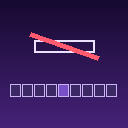
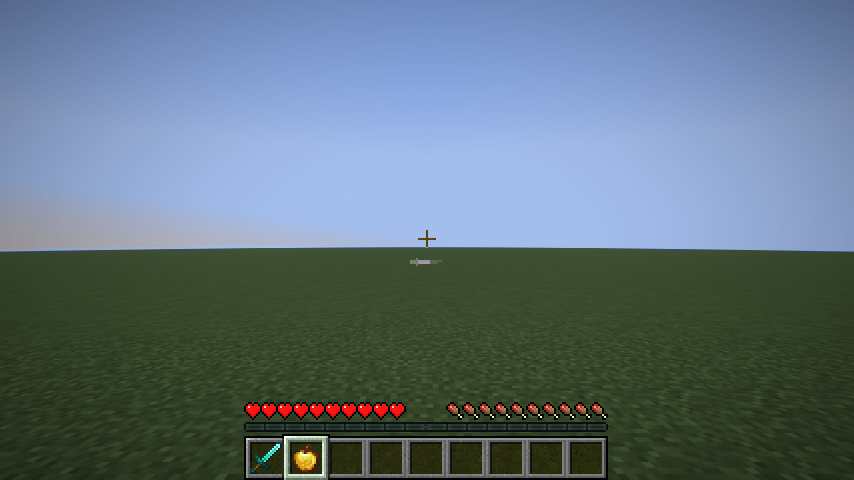

# No Hotbar Name

hides the item name that pops up above the hotbar when you switch to a slot with an item in it. client side fabric mod for 1.21.11, needs only fabric loader.

## download

| jar | minecraft |
|---|---|
| `no-hotbar-name-mc1.21.11-1.0.0.jar` | 1.21.11 |

on the releases page.

## pictures

## license

all rights reserved, made by wysss.
